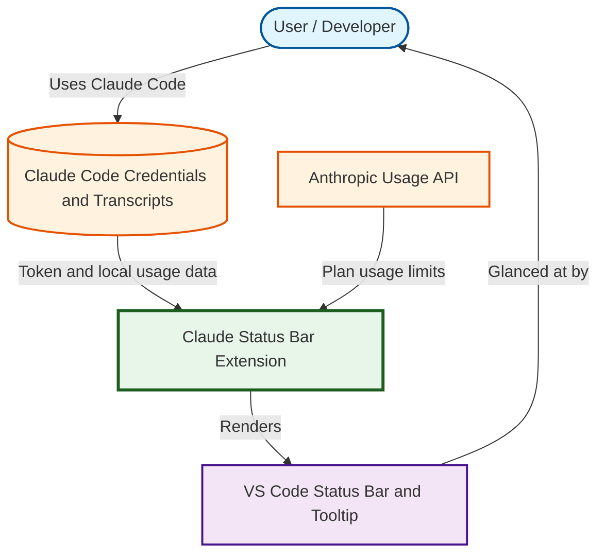

# Claude Status Bar

## Overview

Claude Status Bar is a small VS Code extension that shows your Claude plan usage limits and current Claude Code session info directly in the VS Code status bar.

It saves you from opening claude.ai **Settings > Usage** to check how much of your 5-hour session and weekly limits are left. At a glance you see the active model, a session usage bar with percentage, and the time until the session limit resets. Hovering shows a detailed tooltip.

How it works:

1. **Plan usage limits** — reads the Claude Code OAuth token from Claude Code's own credential store (macOS Keychain, or `~/.claude/.credentials.json` on other platforms) and calls the Anthropic OAuth usage API. The token is kept in memory only and never logged or written.
2. **Session stats** — reads local Claude Code transcripts (`~/.claude/projects/**/*.jsonl`) for the current workspace to get the model, context window usage, and estimated API cost for the session and for today.

End result: a status bar item such as `✦ Opus 5.5  Session ●●●○○○○○○○ 30%  🕒 2h 5m`, which turns yellow at ≥70% and red at ≥90% usage (session or weekly).

The tooltip shows:

- Current session, Weekly · All models, Weekly · Opus, Weekly · Sonnet — percent used and reset time
- Context used / context window of the latest message
- Estimated cost for this session (including subagents) and today across all projects

> Cost is an estimate based on public API prices hardcoded in `extension.js`, not what you are actually billed.

## Diagram



## File Structure

```text
claude-statusbar/
├── extension.js                  # All extension logic (usage API, transcript parsing, status bar)
├── package.json                  # Extension manifest: command, settings, activation
├── .gitignore                    # Ignores build output (*.vsix), node_modules, .env
└── README.md
```

## How to Install

Prerequisites:

- VS Code 1.80 or newer
- Node.js with `npm` / `npx` (to build the `.vsix`)
- `code` command on PATH (VS Code → **Shell Command: Install 'code' command in PATH**)
- Claude Code installed and logged in with a Claude account (OAuth login, not API key)

### Build + install (one command)

```bash
npm run release
```

Every run bumps the running number, packages, and installs it:

1. Bumps the patch version in `package.json` (e.g. `0.0.5` → `0.0.6`). No git commit or tag is created.
2. Packages `claude-statusbar-<version>.vsix` in the repo root.
3. Installs that `.vsix` into VS Code (`code --install-extension`).

Then reload the window (**Developer: Reload Window**).

Commit the `package.json` change so the next build continues from the new number. Built `.vsix` files are not committed (see `.gitignore`). `vsce` is not part of this repo; `npx` downloads it on demand (`@vscode/vsce`).

Other scripts:

| Command | Does |
|---|---|
| `npm run build` | Bump version + package `.vsix` only |
| `npm run install-vsix` | Install the `.vsix` for the current `package.json` version (no bump) |

Or install manually in VS Code: **Extensions** view → `...` menu → **Install from VSIX...** → select the built `.vsix`.

## Required Configuration

No configuration is required. The extension activates on VS Code startup.

Optional settings (**Settings** → search `Claude Status Bar`):

| Setting | Default | Description |
| --- | --- | --- |
| `claudeStatusbar.refreshSeconds` | `5` | How often to re-read local transcripts (min 1s) |
| `claudeStatusbar.usageRefreshSeconds` | `120` | How often to call the usage API (min 30s). Shared by all windows: only one window calls the API per interval |
| `claudeStatusbar.barWidth` | `10` | Number of blocks in the usage bar |

Environment variable:

| Variable | Required | Description |
| --- | --- | --- |
| `CLAUDE_CONFIG_DIR` | No | Custom Claude config folder. Defaults to `~/.claude` |

## How to Run Code

### Use the installed extension

1. Open a workspace folder you use with Claude Code.
2. Look at the right side of the status bar. It shows `กำลังโหลด usage…` briefly, then the model and session usage.
3. Hover for the full usage and cost table.
4. Click the item (or run **Claude Status Bar: Refresh** from the Command Palette) to fetch usage immediately. The click is skipped if any window fetched in the last 30s, or while backing off after a 429.

All VS Code windows share one usage cache (`usage-cache.json` in the extension's global storage; usage numbers and timestamps only, never the OAuth token). A window reuses a result another window fetched, and a 429 pauses fetching in every window.

On macOS, the first usage fetch may trigger a Keychain prompt for `Claude Code-credentials`. Choose **Allow** or **Always Allow**.

### Run from source (development)

1. Open this folder in VS Code.
2. Press `F5` and choose **VS Code Extension Development** if asked (no `launch.json` is included, so VS Code uses its default extension launcher).
3. A new Extension Development Host window opens with the extension loaded.
4. Edit `extension.js`, then run **Developer: Reload Window** in the dev host window to pick up changes.

### Successful run

- Status bar shows the model name, `Session` bar with a percentage, and a clock with time until reset.
- Tooltip lists session and weekly limits with an `usage อัปเดต <time>` line.
- If only `$(warning) usage n/a` appears, see Troubleshooting.

### Testing

No automated tests exist in this repo.

## Outputs, Logs & Important Files

The extension writes no files. It only reads:

| Path | Type | Description |
| --- | --- | --- |
| macOS Keychain item `Claude Code-credentials` | Input (read-only) | OAuth token on macOS |
| `~/.claude/.credentials.json` | Input (read-only) | OAuth token on Linux / Windows |
| `~/.claude/projects/<workspace>/*.jsonl` | Input (read-only) | Claude Code session transcripts |
| `https://api.anthropic.com/api/oauth/usage` | Network | Plan usage limits |

Model prices and context window sizes are in the `PRICING` table at the top of `extension.js`. Update it when new models or prices appear.

Do not commit credentials or transcript files.

## Troubleshooting

| Symptom | Likely Cause | Fix |
| --- | --- | --- |
| `usage n/a` + `Keychain access denied or item missing` | Keychain prompt denied, or Claude Code not logged in | Run `claude` and log in; allow Keychain access on next refresh |
| `no OAuth token (API key login?)` | Claude Code uses an API key, not a Claude account | Log in with a Claude account (`/login` in Claude Code). Usage limits exist only for plan accounts |
| `no ~/.claude/.credentials.json` | Linux/Windows without Claude Code login, or custom config dir | Log in with Claude Code, or set `CLAUDE_CONFIG_DIR` |
| `usage API HTTP 401` | OAuth token expired | Run any Claude Code command to refresh the token, then click the status bar item |
| `usage API rate limited (429) — ลองใหม่ <time>` | Refreshing too often | Wait; all windows back off together (1m → 30m, or `Retry-After`) and show the last cached usage. Increase `claudeStatusbar.usageRefreshSeconds` if it repeats |
| Model shows `Claude`, no context/cost in tooltip | No transcript found for this workspace | Start a Claude Code session in this folder first |
| Model name shows raw ID or cost is `$0.00` | Model not in `PRICING` table | Add the model to `PRICING` in `extension.js` and rebuild |
| Status bar item missing | Extension not activated | Reload the window; check **Extensions** view that it is enabled |
